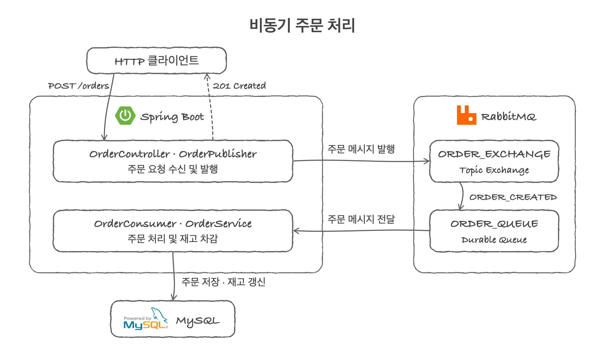

# Order System

주문 요청을 빠르게 접수하면서 같은 상품에 주문이 몰려도 재고 차감을 일관되게 처리하는 방법을 실습한 백엔드 프로젝트입니다. Spring Boot API가 주문 요청을 RabbitMQ에 발행하고, 컨슈머가 MySQL 트랜잭션에서 재고를 차감하고 주문을 저장합니다. 회원·상품 등록 및 조회, 주문 내역 조회와 취소를 지원합니다.

**개발 기간** 2025.03.13–2025.03.18 · 개인 프로젝트

**기술 스택** Java 17 · Spring Boot 3.4.3 · Spring Data JPA · Gradle 8.12.1 · RabbitMQ 3.12.11 · MySQL · Docker Compose

## 로컬 실행

### 1. 의존 서비스 시작

JDK 17과 Docker Compose가 필요합니다. 저장소 루트에서 MySQL과 RabbitMQ를 시작합니다. 이 구성은 호스트의 `3306`, `5672`, `15672` 포트를 사용하며, Spring Boot 앱은 호스트의 `8080`에서 실행합니다. [Compose 설정](docker-compose.yml)

```bash
docker compose up -d mysql rabbitmq
docker compose ps
docker compose exec -T rabbitmq rabbitmq-diagnostics -q ping
```

MySQL이 `healthy` 상태이고 RabbitMQ의 ping이 성공하면 다음 단계로 진행합니다.

### 2. 애플리케이션 시작

앱을 실행할 셸에 로컬 접속 정보를 설정합니다. `SPRING_JPA_HIBERNATE_DDLAUTO=create`는 시작할 때 스키마를 다시 만들므로 실습 DB에만 적용합니다. 시작 시 회원 10,000명과 재고가 각각 10,000개인 상품 4개가 등록됩니다. [초기 데이터 코드](src/main/java/com/jwj/order/util/InitDb.java)

```bash
export SPRING_DATASOURCE_URL='jdbc:mysql://127.0.0.1:3306/orders'
export SPRING_DATASOURCE_USERNAME=root
export SPRING_DATASOURCE_PASSWORD=password
export SPRING_RABBITMQ_HOST=127.0.0.1
export SPRING_RABBITMQ_PORT=5672
export SPRING_RABBITMQ_USERNAME=guest
export SPRING_RABBITMQ_PASSWORD=guest
export SPRING_JPA_HIBERNATE_DDLAUTO=create
```

현재 Gradle 설정에는 Lombok 어노테이션 처리기 선언이 빠져 있습니다. 아래 임시 초기화 스크립트를 사용하면 이 실행에 필요한 처리기를 등록할 수 있습니다. [Gradle 빌드 설정](build.gradle)

```bash
lombok_init="$(mktemp -d)/lombok.init.gradle"
cat > "$lombok_init" <<'GRADLE'
allprojects {
    plugins.withId('java') {
        dependencies.add('annotationProcessor', 'org.projectlombok:lombok')
    }
}
GRADLE
./gradlew --init-script "$lombok_init" bootRun
```

API는 `http://localhost:8080`에서, RabbitMQ 관리 화면은 `http://localhost:15672`에서 접근할 수 있습니다.

## 주문 한 건 확인하기

새로 초기화한 DB에서 회원 `1`이 상품 `1`을 2개 주문하는 예시입니다. 먼저 상품 조회로 현재 재고를 확인한 다음 주문을 요청합니다.

```bash
curl -fsS http://localhost:8080/items/1
curl -i http://localhost:8080/orders \
  -H 'Content-Type: application/json' \
  --data '{"memberId":1,"orderItems":[{"itemId":1,"count":2}]}'
```

주문 요청의 응답은 본문 없는 `201 Created`입니다. 주문 ID는 소비자가 주문을 저장한 뒤 생성되므로 목록에서 확인합니다. 목록이 비어 있으면 주문을 다시 보내기 전에 잠시 뒤 목록을 재조회합니다. 새 DB에서 이 주문 한 건이 반영된 경우 목록에 `ORDER` 상태의 주문이 나타나고 상품 재고는 `10000`에서 `9998`로 줄어듭니다.

```bash
curl -fsS -X GET http://localhost:8080/orders \
  -H 'Content-Type: application/json' \
  --data '{"orderStatus":"ORDER"}'
curl -fsS http://localhost:8080/items/1
```

조회해도 주문이 나타나지 않으면 앱 로그에서 `주문 이벤트 수신 완료` 또는 `주문에 실패했습니다`가 기록됐는지 확인합니다. 주문을 소비하는 컨테이너의 제약은 [재처리 방식과 한계](#재처리-방식과-한계)에 설명합니다.

목록에서 확인한 주문 ID로 취소 요청을 한 번 보내면 `200 OK`가 반환되고 상품 재고가 원래 수량으로 돌아갑니다.

```bash
order_id=1  # 주문 목록에서 확인한 ID로 변경
curl -i -X DELETE "http://localhost:8080/orders/${order_id}/cancel"
curl -fsS http://localhost:8080/items/1
```

## API 참조

| 메서드 | 경로 | 요청 및 결과 |
| --- | --- | --- |
| `POST` | `/members/new` | `name`, `address`로 회원 등록. 성공 시 `201` |
| `GET` | `/members` | 회원 목록 조회. 성공 시 `200` |
| `POST` | `/items/new` | `name`, `price`, `stockQuantity`로 상품 등록. 성공 시 `201` |
| `GET` | `/items/{itemId}` | 상품과 재고 조회. 성공 시 `200` |
| `POST` | `/orders` | `memberId`, `orderItems`를 받아 주문 메시지 발행. 성공 시 `201`, 빈 본문 |
| `GET` | `/orders` | JSON 본문의 `orderStatus`(`ORDER`, `CANCEL`)로 목록 조회. 성공 시 `200` |
| `DELETE` | `/orders/{orderId}/cancel` | 주문 상태를 `CANCEL`로 변경하고 재고 복구. 성공 시 `200` |

배송이 완료된 주문은 취소할 수 없습니다. 같은 주문에 취소를 반복하면 재고가 다시 증가할 수 있습니다. [주문 취소 코드](src/main/java/com/jwj/order/domain/Order.java)

## 주문 처리 설계



### 주문 접수와 저장을 나눈 이유

HTTP 요청이 상품 조회, 잠금 획득, 재고 차감까지 기다리지 않도록 쓰기 작업을 큐 뒤로 옮겼습니다. API는 `ORDER_EXCHANGE`에 `ORDER_CREATED` 키로 발행하는 호출이 끝나면 응답합니다. 이후 메시지가 `ORDER_QUEUE`로 라우팅되면 컨슈머가 주문을 처리합니다. 요청 시점과 저장 시점이 분리되므로 클라이언트는 후속 조회로 처리 결과를 확인합니다. [주문 API](src/main/java/com/jwj/order/controller/OrderController.java) · [메시지 발행 코드](src/main/java/com/jwj/order/rabbitmq/OrderPublisher.java)

### 잠금 범위를 나눈 이유

| 상황 | 적용한 방식 |
| --- | --- |
| 같은 회원의 주문이 겹침 | `GET_LOCK('order_<memberId>', 5)`로 같은 회원의 서비스 콜백 실행을 직렬화합니다. 잠금 획득에 최대 5초를 기다리며, 콜백이 끝날 때 MySQL 세션 잠금을 해제합니다. |
| 서로 다른 회원이 같은 상품을 주문함 | 회원별 잠금으로 보호할 수 없는 상품 재고는 상품 행의 비관적 쓰기 잠금(`PESSIMISTIC_WRITE`)으로 보호합니다. 잠금을 획득한 뒤 재고를 확인하고 차감합니다. |
| 주문 중 재고가 부족함 | 재고 차감과 주문, 주문 상품, 배송 정보 저장을 한 트랜잭션에 묶어 예외가 발생하면 함께 롤백합니다. |

[주문 서비스](src/main/java/com/jwj/order/service/OrderService.java) · [회원별 잠금](src/main/java/com/jwj/order/rabbitmq/LockRepository.java) · [상품 행 잠금](src/main/java/com/jwj/order/repository/ItemRepository.java)

### 재처리 방식과 한계

주문 큐의 메시지 TTL은 60초입니다. 큐에서 만료된 메시지는 데드 레터 교환기를 거쳐 DLQ로 이동합니다. 주문 컨슈머도 처리 예외가 발생하면 DLQ 경로로 메시지를 별도 발행하고 예외를 다시 던집니다. DLQ 컨슈머는 받은 메시지를 주문 큐로 즉시 재발행합니다. [RabbitMQ 설정](src/main/java/com/jwj/order/rabbitmq/RabbitMqConfig.java) · [컨슈머 코드](src/main/java/com/jwj/order/rabbitmq/OrderConsumer.java)

- 최대 3회 시도와 1초 대기를 정의한 설정이 이 경로에 연결되어 있지 않아 계속 실패하는 메시지는 큐를 순환할 수 있습니다. [재시도 설정](src/main/java/com/jwj/order/rabbitmq/RetryConfig.java)
- 주문 요청에 멱등성 키가 없어 같은 메시지를 다시 처리하면 주문 생성과 재고 차감이 중복될 수 있습니다.
- 동시 소비자 10개와 prefetch 20을 지정한 별도 컨테이너에는 메시지 리스너가 연결되어 있지 않습니다. 이 컨테이너가 메시지를 가져가면 주문 처리에 실패할 수 있습니다.

## k6 부하 테스트 기록

개발 당시 주문 요청에 부하를 주고, 가상 사용자 수에 따른 처리량과 응답 지연을 기록했습니다. 상품 한 종류의 재고 감소량도 확인했습니다. 다음 수치는 기존 README에 남은 측정 기록입니다.

### 확인 가능한 실험 조건

| 항목 | 남아 있는 기록 |
| --- | --- |
| 실행 환경 | 기존 기록에 EC2 `t3.small`이 명시되어 있습니다. k6와 Spring 앱은 별도 EC2 인스턴스에 표시되어 있습니다. `t3.small`이 어느 쪽에 해당하는지와 MySQL·RabbitMQ 배치 위치는 확인할 수 없습니다. [당시 실험 구성도](https://github.com/user-attachments/assets/aadf9fd0-ace5-4600-b6bd-86b66c6ff234) |
| 부하 규모 | k6 가상 사용자 1,000 / 2,000 / 4,000명 |
| 데이터 확인 범위 | 각 실험에서 상품 한 종류의 재고 감소량 확인 |
| 확인할 수 없는 조건 | k6 스크립트와 실행 명령, 가상 사용자 증가 방식과 실행 시간, 반복 횟수, 테스트한 커밋, 재고 확인 시점 |

### 측정 결과

| 가상 사용자 | 초당 처리량 | 응답 지연 | HTTP 요청 실패(원문 표기) | 재고 감소량 |
| ---: | ---: | ---: | ---: | ---: |
| 1,000 | 668.4/s | 약 23 ms | 0/s | 1,000개 |
| 2,000 | 1,340/s | 약 21 ms | 0/s | 2,000개 |
| 4,000 | 2,230/s | 약 237 ms | 0/s | 4,000개 |

기존 기록에는 처리량의 집계 기준, 응답 지연의 통계 종류(평균·백분위수 등), HTTP 실패 지표의 계산 방법이 남아 있지 않습니다. 따라서 4,000명 실험에서 보고된 지연이 더 컸다는 점까지 확인할 수 있습니다. 주문 전체의 처리 성능을 비교하려면 HTTP 응답 시간과 DB 저장 완료까지 걸린 시간을 각각 측정해야 합니다.

같은 비교를 다시 수행할 때는 부하 생성기와 서버의 사양, 인스턴스 배치, 앱 커밋과 큐 설정, 초기 재고, k6 스크립트와 실행 시간, 반복 횟수를 함께 기록합니다. 각 실행 후에는 큐 처리 완료 시점의 주문 건수와 재고를 확인하고, HTTP 지연은 통계 종류와 함께 보고합니다. [SPEC — Run and Reporting Rules](https://open.spec.org/osg/policy/#274-run-and-reporting-rules)

## 배포 구성

GitHub Actions 워크플로는 `master` 브랜치에 푸시하면 EC2에 SSH로 접속해 설정 파일을 생성하고 JAR 빌드와 Docker Compose 실행을 시도하도록 구성되어 있습니다. Dockerfile에는 이미 빌드된 JAR가 필요합니다. Compose 안에서 앱을 실행할 때는 DB와 브로커 호스트에 서비스 이름 `mysql`, `rabbitmq`를 사용합니다. [배포 워크플로](.github/workflows/deploy.yml) · [Dockerfile](Dockerfile)
